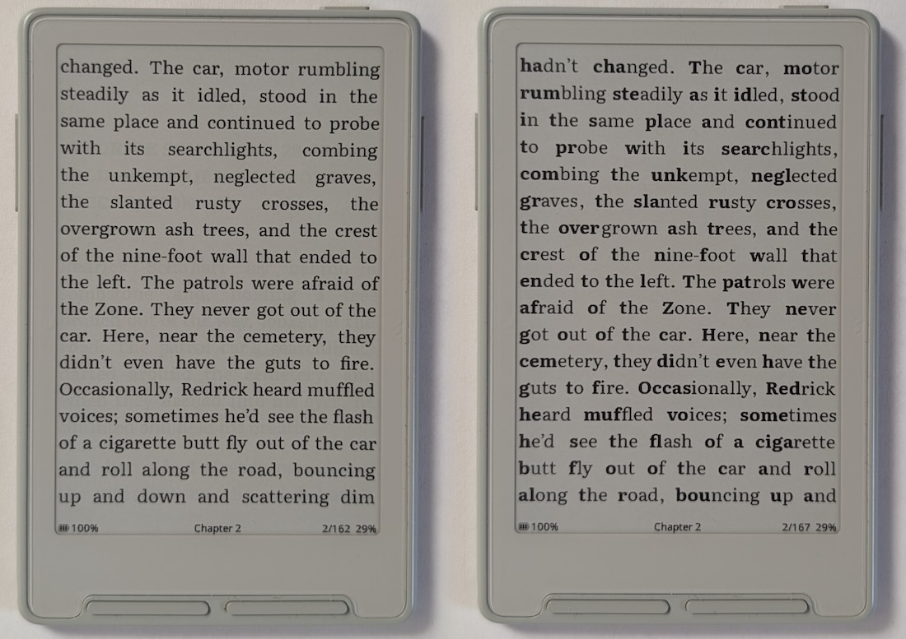
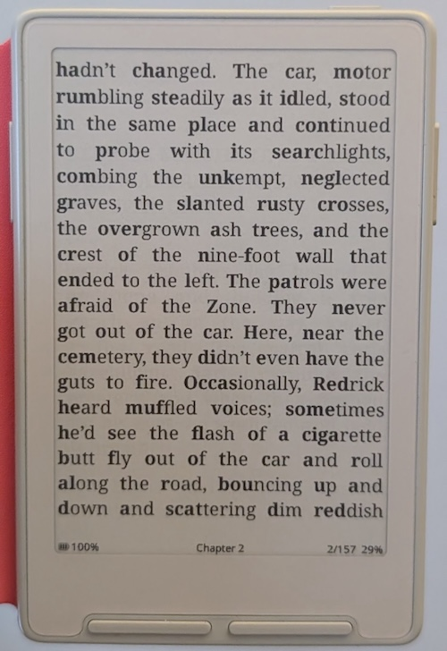
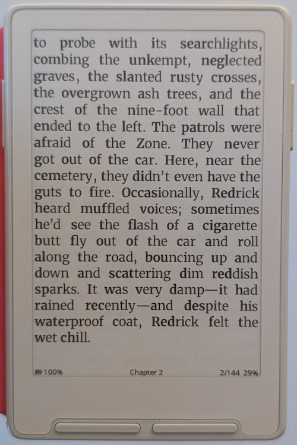
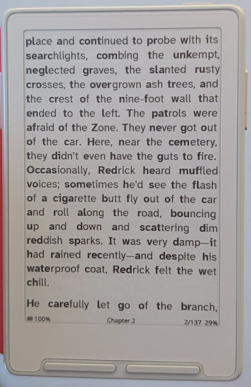

# Reader Features

This page covers reader features that go beyond basic page turning. It is not a complete list of every reader setting. For everything that changed in each version, see the [releases page](https://github.com/uxjulia/CrossInk/releases).

## In-book Reader Options

You can change how a book looks without leaving it. Open the Reader Menu from
inside the book (on button devices, press **Confirm**).

EPUB books use five icon tabs. The **Font** and **Layout** tabs hold things
such as:

- Font family and font size
- Line spacing, word spacing, and character spacing
- Margins and alignment
- Image display and [image grayscale](#images-and-grayscale)
- [Publisher Page Numbers](#publisher-page-numbers)
- [Focus Reading](#focus-reading) and [Guide Dots](#guide-dots)

Changes take effect straight away, with a live preview for font, spacing, and
margin choices. The **More**, **Bookmarks**, and **Settings** tabs hold
navigation, reading tools, and per-book settings. See the
[Reader Menu](./user-guide.md#5-reader-menu) for the full tab map and button
controls.

Layout choices such as font size and margins can be saved for just that book,
and they win over your global defaults. Status bar settings are always global.
See [Global settings and individual books](./user-guide.md#362-reader) to
restore a book to your global defaults.

If a book is slow to open or will not open because of complex publisher
styling, see [EPUB Indexing Methods](./epub-indexing.md) and
[EPUB Render Modes](./epub-render-modes.md).

## Focus Reading

Focus Reading is a reading aid that bolds the first portion of each word,
guiding your eyes to natural fixation points and helping you read faster with
less effort. Some readers, particularly those with ADHD, find it helps them
stay engaged with the text and reduces mind-wandering.

### Enabling Focus Reading

1. Open **Settings > Reader**.
2. Turn **Focus Reading** on.

You can also turn it on from the Reader Menu's **Font** tab. The book is laid
out again, just as when you change the font, so give it a moment. Your EPUB
file is not changed.

### Examples

_Left: Focus Reading off. Right: Focus Reading on. Both using Literata._

_Focus Reading with Noto Serif font._

_Focus Reading with Merriweather font._

_Focus Reading with Atkinson Hyperlegible Next font._

### Notes

Focus Reading only applies to regular body text. Already-bold text, including
headings and emphasis, is left unchanged.

## Font Sizes And Downloadable Font Ranges

CrossInk offers a wide range of font sizes, from small for dense pages to very large text.

The reader can also use font packs stored on the SD card, with a choice of size ranges. This keeps the device's built-in storage free while still giving you extra sizes and custom fonts.

Related docs:

- [SD Card Fonts](./sd-card-fonts.md)

## Custom Scalable Fonts

On Sticky and X4 Pro (the ESP32-S3 readers), you can use your own TrueType
(`.ttf`) or OpenType (`.otf`) fonts. Copy the files into the `/fonts` folder on
the SD card, either together or in a folder named after the font family. Restart
the reader or refresh its font list, then choose the family from the font
picker.

For the full range of text styles, include all four faces: regular, bold,
italic, and bold italic. A family with fewer faces still works, but some styles
fall back to another face. Variable fonts and font collections are not
supported.

See [Scalable Fonts](./scalable-fonts.md) for installation details and limits.

## Reader Status Bars

The status bars are the strips at the top and bottom of the page. You can set
them up separately from **Settings > Reader > Status Bars**, or from the EPUB
Reader Menu's **Settings** tab, then **Status Bars**.

- Each bar has three left slots, one center slot, and three right slots. Fill
  each with an item such as the book or chapter title, chapter page count,
  book progress percentage, Time Left, clock, date, battery, or
  [Stable Page Numbers](#stable-page-numbers), or leave it **Empty**.
- Each bar can show a progress bar for the book or chapter, and you can hide a
  bar without losing the items you chose for it.
- **Status Bar Text Size** can be **Small**, **Medium**, or **Large** for the
  reader bars, with a separate size for the global header strip shown on other
  screens.
- **Battery** can be **Icon + %**, **Icon Only**, or **% Only**, set separately
  for the top bar, the bottom bar, and the global strip.
- XTC books use their own **XTC Status Bar** option.

The editor previews each bar where it appears while reading. These settings
apply to every book. On a touchscreen you can also tap the bar while reading to
hide it for a moment (see [Controls](./controls.md#tap-to-hide-status-bar)).

## Dark Reader Mode

Dark Mode reverses the display colors so text is shown light on dark in the
reader and menus. Turn it on from **Settings > Display > Dark Mode**.

You can also give **Dark Mode** to a button or gesture shortcut, to switch it
without opening Settings. See [Controls](./controls.md).

## Line, Word, And Character Spacing

Three sliders change how tight or airy the text feels, without changing the font
size. Use them when a book looks cramped, or when larger text needs more room.

- **Line Spacing** sets the space between lines, from compact to wide.
- **Word Spacing** (EPUB only) ranges from -4 to +4. Positive values add space
  between words and negative values pull them closer.
- **Character Spacing** ranges from -5 to +5 and adjusts the space between
  letters. It works in EPUB and TXT books.

To change them while reading, open the Reader Menu, then use **Font > Line/Word
Spacing** (for line and word spacing) or **Font > Reader Font > Character
Spacing**. Each slider shows a live preview. To set defaults for all books, use **Settings > Reader >
Font Options**.

Changing a spacing setting lays the book out again, so the number and positions
of pages may change.

## Publisher Page Numbers

Publisher Page Numbers show page labels supplied by the EPUB, such as the
printed page numbers from a physical edition. When the book includes labeled
page-break markers, CrossInk displays those labels in the reader margin beside
the matching content.

To turn them on, open the Reader Menu and select **Layout > Publisher Page
Numbers**, or use **Settings > Reader > Publisher Page Numbers**. If the EPUB
has no labeled page-break markers, there is nothing to show.

Publisher page markers are kept by the **CrossInk Default** and **Balanced**
render modes. **Light** and **Safe Mode** leave them out.

## Stable Page Numbers

Stable Page Numbers show a page number in the status bar, such as `120/540`,
that does not change when you change the font, spacing, or orientation. This
makes them handy for saying "I am on page 120" and finding the same place later.
They come from fixed reference-page information stored in the EPUB, not from
the current screen layout.

To turn them on:

1. Open the Reader Menu and select the **Settings** tab.
2. Select **Status Bars**.
3. Select **Top Status Bar** or **Bottom Status Bar**.
4. Choose a left, center, or right slot, then select **Stable Page Numbers**.

You can then jump to a page with **Go to Stable Page** on the Reader Menu's
**More** tab.

A page number appears only if the EPUB contains this reference information. To
add it, optimize the EPUB in the CrossInk web interface (see
[File Transfer](./webserver.md)) or with [Inky](https://inky.crossink.dev)
before copying it to the reader. In the optimizer's settings,
**Characters per Page** sets the size of a reference page. The default is 1,500
characters. Lower values make more, shorter pages, and higher values make fewer,
longer ones.

Stable Page Numbers are not publisher or printed-edition page numbers. Use
[Publisher Page Numbers](#publisher-page-numbers) when you want the page labels
provided by the book itself.

## Images And Grayscale

EPUB images can be shown, replaced with a placeholder, or hidden. Choose
**Images** in **Settings > Reader**, or on the Reader Menu's **Layout** tab.

**Image Grayscale** controls whether pictures are drawn in shades of gray (on
by default) or in plain black and white. Gray usually looks better for photos. It is separate from **Text Anti-Aliasing**, which only
smooths text. Turn it on or off for all books in **Settings > Reader > Image
Grayscale**, or for one book from the Reader Menu's **Layout** tab.

## Select Chapter

To jump to a chapter, open the Reader Menu's **More** tab and select **Select
Chapter**. It works in EPUB and XTC books that have a chapter list. You can also
give **Select Chapter** to a button, a Quick Actions slot, or a touch gesture to
open the list directly. See [Controls](./controls.md).

## Guide Dots

Guide Dots adds small dots between words. The idea comes from speed-reading guidance where focusing on the space between words can help peripheral vision pick up more of the surrounding text.

Turn it on from **Settings > Reader > Guide Dots**, or from the Reader Menu's
**Font** tab.

## Force Paragraph Indents

Some books do not define paragraph indents in a way the firmware understands, which can make the page look like one large wall of text.

Force Paragraph Indents adds an indent at each new paragraph regardless of how the book is formatted.

This works when **Paragraph Alignment** is set to:

- **Left**
- **Justify**
- **Book's Style**

Turn it on from **Settings > Reader > Page Layout > Force Paragraph Indents**,
or from the Reader Menu's **Layout** tab.

## Auto Page Turn

Auto Page Turn advances pages on a timer while you read, which is handy for
hands-free reading.

You can pick any interval from 5 to 120 seconds, and the reader can remember a
different interval for each book. Open the Reader Menu's **More** tab and select
**Auto Page Turn** to set it up.

## Time Left

CrossInk can show an estimate of the time left in the current chapter or book.
Add **Time Left** to a [status bar](#reader-status-bars) to see it.

The estimate is based on how fast you have been reading recently. Jumps such as
skipping a chapter, going to a bookmark, or following a footnote do not throw it
off.

If the estimate was thrown off by unusual reading (for example, skimming), use
**Reset Reading Pace** in the EPUB Reader Menu's **Settings** tab to start
learning again from fresh page turns.

## Bookmarks

CrossInk supports EPUB bookmarks from the reader.

You can:

- Add a bookmark while reading
- See bookmark indicators in the reader
- Open a bookmark list
- Jump back to saved locations
- Delete individual bookmarks

## Clippings And Highlights

CrossInk supports EPUB text clippings from the reader. Use **Create Clipping**
from the reader menu or a configured shortcut, select text, and save it.

On button devices, move the cursor with the direction buttons, press **Select**
at the first word, move to the last word, then press **Done**. On touchscreen
devices in Create Clipping mode, tap the first and last words, or touch and
hold the first word, drag to the last word, then lift your finger to save.
Hold on the page's final word for about one second to extend onto the next
loaded page.

You can also touch and hold text directly on the EPUB reading page with
**Touch Reader Controls** enabled. Drag to select a phrase if needed, then
lift your finger and choose **Create Clipping** or **Look Up**. Clipping is
available even without a dictionary; lookup requires an active dictionary.

A saved clipping is used in three ways:

- It appears as a highlight in the reader
- It appears in the in-app clipping list for that book
- It is appended to `/My Clippings.txt` on the SD card in a Kindle-style text format

The in-app clipping list is stored separately from the text export. Deleting a
clipping from CrossInk removes the saved clipping and highlight from the device
UI, but it does not rewrite old entries that were already appended to
`/My Clippings.txt`.

Open **Clippings** from the Reader Menu's **Bookmarks** tab after saving a
clipping. On touchscreen devices, tap a clipping to read its full text, swipe
up or down to move through a long clipping, and tap **Open** to return to its
location in the book. Touch and hold a clipping in the list, or its text in
the detail view, to open the delete action. Deleting removes the in-app
clipping and its highlight, not an entry already exported to
`/My Clippings.txt`.

## Reading Stats

CrossInk keeps track of your reading time for each EPUB and XTC book and adds
it up into all-time totals. To see a book's **Reading Stats** without opening
it, long-press the book in **Library** or **Browse Files** and choose **Reading
Stats**.

Tracked stats include:

- Total reading time
- Number of sessions
- Pages turned
- Average session time
- All-time totals, including total books read
- Reading time for each day, with today's total and a 7-day average on the
  **This Device** stats page

Newer versions add reading-streak and time charts, editable stat dates, idle-time
filtering, reset controls, and backups. Reading stats can also be shown as a
sleep screen, including **Minimal Stats**.

> [!NOTE]
> Date-based stats need a device with a real-time clock (RTC). The X4 does not
> have one, so it shows less detailed stats than the X3.

For two-device syncing, see [Reading Stats Sync](./reading-stats-sync.md).

### Turn tracking on or off

The switch for all books is **Settings > System > Reading Stats > Track Reading
Stats**. When it is off, CrossInk stops recording new stats. It does not delete
anything you have saved. Turn it back on and your history returns and recording
resumes. Reading done while tracking was off is not added afterwards.

While tracking is off, the menus and Home screens that show stats hide them. The
Dashboard can still show a saved Time Left estimate. The **Reading Stats** and
**Minimal Stats** sleep screens fall back to the regular **Minimal** sleep
screen. The switch itself always stays in Settings so you can turn tracking back
on.

You can also pause stats for a single book while tracking is on. For an EPUB,
use **Track Reading Stats** in the Reader Menu's **Settings** tab. For an XTC
book, use it in its Reader Menu. You can also find it in the book's **Library**
or **Browse Files** menu. Pausing keeps the book's saved stats, stops adding new
ones (including to the all-time totals), and hides that book's **Reading
Stats** view. Turn it back on to show the history and resume recording.

## Nearby Position Sync

CrossInk can copy your place in an EPUB from one nearby CrossInk reader to
another, directly and without Wi-Fi or an account. Open the same EPUB on both
readers, then open **Nearby Position Sync** on both. On button devices it is in
the Reader Menu's **Bookmarks** tab. You can also give it to a shortcut. Press
**Share** on the reader that is already at the correct page.

The receiving reader shows the incoming position and only applies it after you
confirm it.

For details and troubleshooting, see [Nearby Position Sync](./nearby-position-sync.md).

## Finished Books And Read Folder

You can mark a book as finished from the Reader Menu's **Settings** tab (the
same row changes to **Mark as Unfinished** afterwards). At 99% progress,
CrossInk also asks whether to mark the book as finished.

Finished EPUB and XTC books show a checkmarked book icon in **Browse Files** and
in the **Library** list, so you can see at a glance what you have read.

Marking a book as finished also counts toward your total **Books Read** stat.
You can mark books as finished from **Browse Files** without opening them.

Two optional settings in **Settings > System > Files & Cache** tidy up after
finished books: **Move Finished Books to Read Folder** moves them to `/Read/` on
the SD card, and **Clear Finished Books from History** removes a book from your
recent books once you reach its end.

## Reader Controls And Shortcuts

CrossInk adds reader-focused control options beyond the default button mappings.

Examples include:

- Reader-only front-button actions
- Front and side button mappings that follow the current orientation
- Tilt page turns (X3 and Sticky)
- Shortcut actions on the Power button and button combinations
- Touch gestures such as pinch to resize the font (touchscreen devices)
- Side-button shortcuts for changing font size, chapter, or orientation
- Quick access to Controls from the Reader Menu's **Settings** tab

For the full controls reference, see [Controls](./controls.md).
